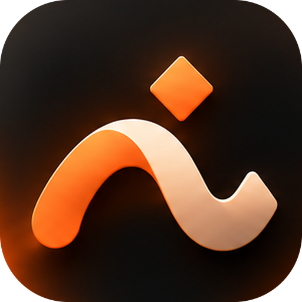

<p align="center"></p>

<h1 align="center">Athar</h1>

<p align="center">Keep what matters: notes, journal and clipboard history in plain files, by <a href="https://github.com/zimamlabs">Zimam Labs</a>.</p>

<p align="center">
  <a href="../../releases/latest"></a>
  <a href="../../releases"></a>
  <a href="LICENSE"></a>
</p>

Athar (أثر, a lasting trace) is one private place to capture a thought, keep Markdown notes, write a daily journal and, on the desktop, keep a history of what you copied. Everything is plain files in a folder you own, so it works offline, opens in any editor and moves between computers by copying the folder. No account, nothing sent anywhere.

Athar is the home of notes and journal that used to live in Thabit (formerly Dawem), and it can import them.

## Screenshots

Screenshots: coming with the next release.

## Features

- **Home**: a greeting, a capture box (one tap or Ctrl+Alt+N inside the window), your writing numbers (words, this week, day streak, notes), pinned and recent notes, today's journal, "on this day" from earlier years and, on the desktop, what you copied lately.
- **Notes**: Markdown with a reading view and an edit view, tags, collections (folders), pin, favorite, archive and trash with restore. Typing is saved by itself. The note header (`id`, `title`, `created`, `updated`, `tags`, `pinned`) is the same as Thabit's and Dawem's, so notes copy between the apps.
- **Journal**: one entry a day, a month calendar with a dot on the days you wrote, earlier and later entry, an optional mood, a look-back list and a day count streak.
- **Clipboard history** (desktop only): records the texts you copy while it is on, keeps up to 500, skips repeats, lets you pin, copy back, delete and clear, and shows clearly whether it is recording. It is off until you turn it on, never reads the clipboard while off, skips texts that match your own patterns and has a "skip the next copy" button. Android does not let an app watch the clipboard in the background, so this part is desktop only.
- **Search** across notes, journal and clipboard, best match first (title, tag, collection, then body), with a snippet.
- **Insights**: words, notes made, days written and mood over 7, 30 or 90 days, a bar a day, and your streaks.
- **Import from Thabit or Dawem**: Settings and the first-run tour find a vault in the usual places (`Zimam/Thabit`, `Zimam/Dawem`, `~/Dawem`) or take a folder path, and **copy** its `notes/` and `journal/` here. Every file is checked by size and SHA-256, nothing is overwritten (a different file with the same name is kept beside it as `name (from Thabit).md`), the old folder is never changed or deleted, and running it twice copies nothing new.
- **English and Arabic**, right to left, with a choice of Western or Arabic-Indic digits.
- **Themes**: System, Light or Dark, in the Zimam look, plus other palettes.
- **First-run tour** and a one-time **What's new** after each update.

## Where your data lives

Athar keeps one vault folder: `Zimam/Athar` (on the phone when you allow *All files access*, otherwise a private folder; `~/Zimam/Athar` on the desktop).

```
notes/<title>-<id>.md        Markdown with a small header
journal/<year>/<date>.md     one file a day, the mood in the header
clipboard/history.json       the copies Athar recorded (desktop)
exports/                     vault zips you export
.athar/                      settings and the trash
```

Moving to the visible folder never risks your data: Athar copies, checks every file by size and SHA-256, and only then uses the new folder; the old folder is kept as a backup until you remove it from Settings, which asks and checks again.

## Privacy

No account, no tracking, no network. The clipboard history is a file in your folder; you can pause it, exclude texts, clear it or delete the file.

## Download

Get the file for your system from the [latest release](../../releases/latest). Next to every file is a checksum file with the same name plus `.sha256`.

| System | File |
|---|---|
| Android phone (64-bit, almost every phone since 2016) | `Athar_<version>_Android_arm64-v8a.apk` |
| Android, older 32-bit | `Athar_<version>_Android_armeabi-v7a.apk` |
| Android emulator, Chromebook | `Athar_<version>_Android_x86_64.apk` |
| Debian, Ubuntu, Mint | `Athar_<version>_Linux_amd64.deb` |

```
sha256sum -c Athar_<version>_Linux_amd64.deb.sha256
sudo apt install ./Athar_<version>_Linux_amd64.deb
```

For the APK, check the file before you install it:

```
sha256sum -c Athar_<version>_Android_arm64-v8a.apk.sha256
```

### Verify the Android download

Every APK is signed with Athar's own key. Android installs it without a store because the signature is valid, and shows its usual "unknown source" notice for anything that did not come from Google Play. To check a file is really ours, compare its signing certificate with this fingerprint:

```
SHA-256: 50:40:7E:A0:96:4C:A5:85:D5:F9:C7:93:9F:6D:37:A5:3C:E3:03:67:14:5A:11:F0:23:9F:5E:0F:01:F0:26:3E
```

```
apksigner verify --print-certs Athar_<version>_Android_arm64-v8a.apk
sha256sum -c Athar_<version>_Android_arm64-v8a.apk.sha256
```

## Build

You need JDK 17 or newer and, for Android, the Android SDK (platform 36).

```
./gradlew :shared:desktopTest :feature-notes:desktopTest :feature-journal:desktopTest :feature-clipboard:desktopTest :ui:desktopTest :core:desktopTest
./gradlew :composeApp:run                # run it on the desktop (data in ~/Zimam/Athar)
./gradlew :composeApp:assembleDebug      # Android debug APKs
./gradlew :composeApp:packageDeb         # Linux .deb
scripts/check-modules.sh                 # the module rules
```

The code is split in modules: `core` (files, settings, migration), `ui` (theme, strings, shared widgets), one feature module each for notes, journal and clipboard (they depend only on `core` and `ui`, which the check enforces), `shared` (the vault, search, import) and `composeApp` (the screens for both platforms). The app's texts live in `ui/.../StringsEn.kt` and `StringsAr.kt`; a test fails when a key is missing in one of them.

## Roadmap

A system-wide capture shortcut, backlinks between notes, attachments, images in the clipboard history, sync between devices (later), and a Windows and macOS edition. Thabit's notes and journal move here.

## Licence

MIT. See [LICENSE](LICENSE).
